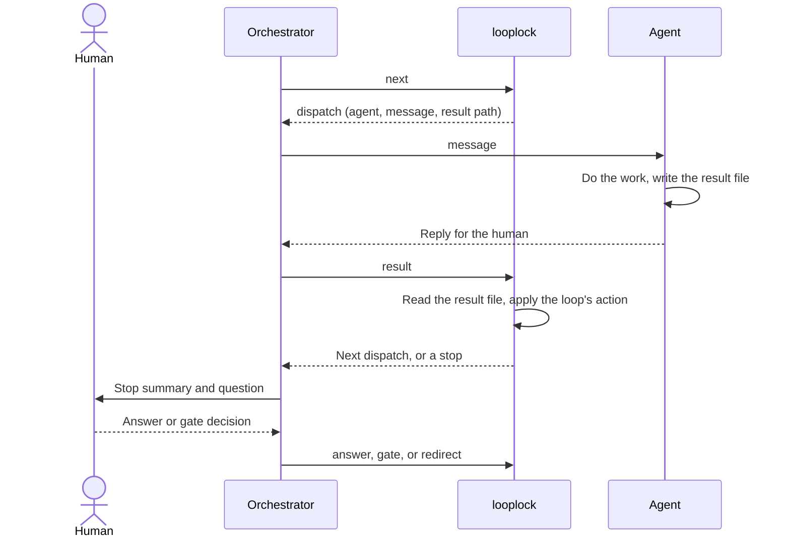

# Looplock

LLMs do the work. Looplock decides what happens next.

Looplock is a deterministic control plane for agentic engineering workflows. It moves routing, retries, approvals, failures, and stop conditions out of prompts and into code that you can test.

## The problem

A multi-agent workflow often keeps its control logic in prose: orchestration prompts, instructions in `AGENTS.md` files and agent definitions, conventions about which agent runs next, and ad hoc retry limits. This works for simple happy paths. It gets much harder to reason about once the workflow has to support human decisions, retries, partial failures, invalidated work, and resumed runs.

At that point the workflow is a state machine, implemented partly in natural language. The LLM does the work, and you also ask it to remember and enforce the protocol that governs the work. The more important the workflow becomes, the less you want to rely on that.

Consider a dependency remediation workflow: discover the dependency, analyze its reachability, propose a fix, get a security approval, implement the fix, run the tests, and verify that the vulnerability is gone. An LLM can do most of those steps. Don't let it decide whether the approval can be skipped, whether a failed verification can be ignored, or whether the run has retried too many times. A loop configuration makes those decisions instead: the run can't reach the implementation without the approval, a failed verification sends the run back to the implementation, and a limit parks the run after too many failures.

## How Looplock works

Agents own execution. Looplock owns protocol. A dispatch can go to Claude Code, Codex, a custom MCP agent, a CI process, or a human, and Looplock handles each the same way: it needs a dispatch message and a structured result file.

Your orchestrator drives the loop with two calls, plus one command for each human decision. `next` prints the move the run needs, and `result` reads the file the agent wrote and applies the loop's rule for it. The following diagram shows one dispatch and one human stop:



The `looplock` CLI keeps each run's state in a JSON file and refuses any move the loop configuration doesn't allow. The orchestrator doesn't interpret routing instructions: it carries each message to its agent and each result back to the CLI, and it can be an agent, a script, or you at a terminal. A sub-agent doesn't need the orchestration graph either. It receives one task, performs it, and writes one structured result. The agent can still write a human-readable reply, but Looplock reads only the result file.

## A loop in code

A loop is a TypeScript module that exports a `defineLoop` configuration. The following excerpt of `presets/default.mts` shows the statuses, the gate, the verify phase, and how the builder's and the verifier's results route:

```ts
import { defineLoop } from '../engine.mts';

export default defineLoop({
    name: 'default',
    inputs: { required: ['subject'] },
    initial: 'plan',
    states: {
        plan: ['gate', 'blocked'],
        gate: ['build', 'plan', 'blocked'],
        build: ['verify', 'blocked'],
        verify: ['blocked'],
        done: [],
        blocked: ['plan', 'gate', 'build', 'verify'],
    },
    artifacts: { plan: { store: 'versioned', projection: 'all' } },
    gates: { gate: { label: 'Gate', freezes: 'plan', next: 'build', back: 'plan' } },
    verify: { verify: { phase: 'build', pass: 'done', fail: 'build' } },
    invalidate: { from: ['build', 'verify'], to: 'plan', proofFrom: ['verify'] },
    byStatus: { build: 'builder', verify: 'verifier' },
    dispatches: {
        builder: { agent: 'builder', message: (s) => `Build the plan ${s.plan}. Run: ${s.runPath}.` },
        verifier: { agent: 'verifier', message: (s) => `Verify the build against ${s.plan}. Run: ${s.runPath}.` },
    },
    results: {
        builder: { ok: { transition: 'verify' }, blocked: { park: true } },
        verifier: { pass: { verify: 'pass' }, fail: { verify: 'fail' }, 'plan-invalidated': { invalidate: true }, blocked: { park: true } },
    },
    stops: ['done'],
    // Left out: the planner's dispatch and results, the route that picks the planner, and the limits.
});
```

In `states`, `verify` lists only `blocked`. A verdict moves the run out of `verify`, so the run reaches `done` only through a recorded pass. For every field, see [Configuration](docs/configuration.md).

## Scope

Looplock isn't an agent framework. It never starts an agent: `next` prints the dispatch, and your runtime runs it. It doesn't decide how an agent reasons, which model it uses, or how it edits code. It also isn't a durable execution platform such as Temporal: it has no distributed scheduling, queues, cloud execution, model hosting, or agent memory.

Its scope is small on purpose. Looplock fits workflows where agents or humans do the work, where failures and approvals matter, and where the protocol matters enough to formalize, inspect, and test.

## What the engine enforces

The engine checks the run file on every call. These rules hold for every loop:

- A run moves only along the configured `states`.
- A gate's approval freezes its artifact, and only an invalidation re-opens it. A rejection records the human's note for the next dispatch.
- Human decisions go into an append-only ledger, and the artifact a gate freezes must apply every active decision.
- The CLI re-dispatches an unusable or refused result with the reason, and parks the run for a human past a limit.
- Every verdict cites a proof report on disk, and a run cites each report once.
- Looplock stores each artifact with its sha256 and refuses a file that changed. A run refuses every command after its loop configuration, or a local file the configuration imports, changes.

For every rule and the terms it uses, see [Protocol rules](docs/protocol.md).

## Quick start

You need Node.js 22.18 or later. Looplock has no npm dependencies and no build step. Clone the repository, run the tests, and start a run of the default loop:

```bash
git clone https://github.com/push-based/looplock.git
cd looplock
node --test *.spec.mts
node bin.mts new --config presets/default.mts --run runs/example/run.json --subject 'the settings page'
node bin.mts next --run runs/example/run.json
```

`next` prints the first dispatch: the planner's message, which ends with the path of the result file the planner writes.

```json
{"do":"dispatch","id":1,"agent":"planner","message":"Plan the settings page. Run: runs/example/run.json. Result: runs/example/results/1.json."}
```

To play each agent by hand through the gate, the build, and the verification, continue with [Run the default loop by hand](docs/tutorial.md).

## Documentation

The following pages cover the rest:

- [Run the default loop by hand](docs/tutorial.md): play every agent and take a run to `done`.
- [Protocol rules](docs/protocol.md): the terms, the rules, result handling, and verification.
- [Configuration](docs/configuration.md): every `defineLoop` field and result action.
- [CLI reference](docs/cli.md): the commands, their flags, and the exit codes.
- [Writing agents](default-agents/README.md): agent skeletons for the default loop.
- [Testing](docs/testing.md): test a loop with `node:test`, and run the engine's tests.
- [Run format](docs/run-format.md): the files a run writes.
