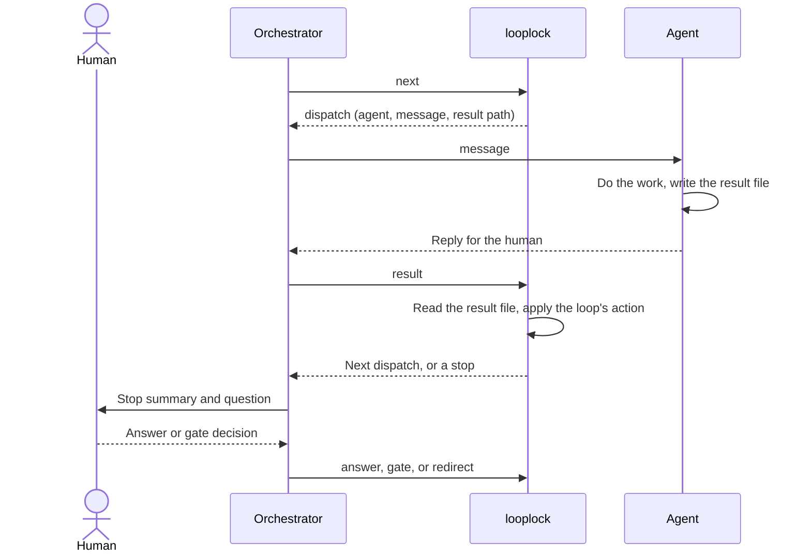
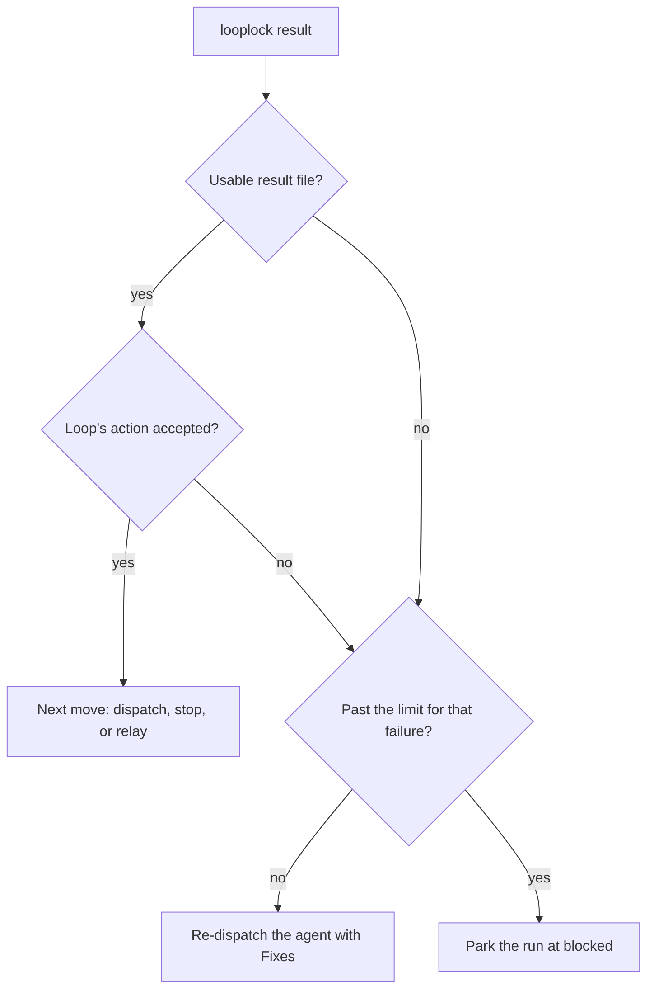
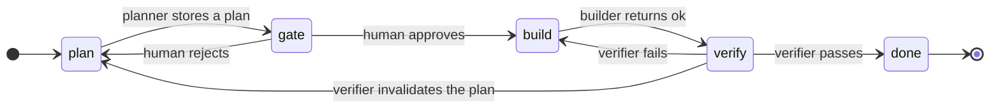

# Looplock

LLMs do the work. Looplock decides what happens next.

Looplock is a deterministic control plane for agentic engineering workflows. It turns orchestration instructions, such as routing, retries, approvals, failures, and stop conditions, from prompt prose into a state machine that you can run and test. The `looplock` CLI keeps each run's state in a JSON file and refuses any move the loop configuration doesn't allow.

## The problem

A multi-agent workflow often keeps its control logic in prose: orchestration prompts, instructions in `CLAUDE.md` files and agent definitions, conventions about which agent runs next, and ad hoc retry limits. This works for simple happy paths. It gets much harder to reason about once the workflow has to support human decisions, retries, partial failures, invalidated work, and resumed runs.

At that point the workflow is a state machine, implemented partly in natural language. The LLM does the work, and you also ask it to remember and enforce the protocol that governs the work. The more important the workflow becomes, the less you want to rely on that.

Consider a dependency remediation workflow: discover the dependency, analyze its reachability, propose a fix, get a security approval, implement the fix, run the tests, and verify that the vulnerability is gone. An LLM can do most of those steps. Don't let it decide whether the approval can be skipped, whether a failed verification can be ignored, or whether the run has retried too many times. A loop configuration makes those decisions instead: the run can't reach the implementation without the approval, a failed verification sends the run back to the implementation, and a limit parks the run after too many failures.

## How Looplock works

Your orchestrator drives the loop with two calls, plus one command for each human decision. `next` prints the move the run needs, and `result` reads the file the agent wrote and applies the loop's rule for it. The following diagram shows one dispatch and one human stop:



The orchestrator doesn't interpret routing instructions after each step. It carries each message to its agent and each result back to the CLI, and it can be an agent, a script, or you at a terminal. A sub-agent doesn't need the orchestration graph either: it receives one task, performs it, and writes one structured result.

Agents own execution. Looplock owns protocol. A dispatch can go to Claude Code, Codex, a custom MCP agent, a CI process, or a human, and the CLI handles each the same way. The agent can still write a human-readable reply, but Looplock reads only the result file, so the orchestrator never parses conversational output to infer whether an agent succeeded.

## Rules the engine enforces

The rules use these terms:

- **Dispatch**: one task for one agent, as a message and the path of the result file the agent writes.
- **Artifact**: a file an agent stores in the run, such as a plan.
- **Gate**: a status where the run waits for a human to approve or reject an artifact. An approval freezes the artifact.
- **Obligation**: a claim in the frozen artifact that a verifier must prove, with the tier of proof it needs. The CLI's messages call the tier the evidence mode.
- **Decision**: a human's answer to an agent's question, kept in the run's ledger.
- **Park**: move the run to `blocked` and wait for a human.

The engine checks these rules against the run file on every call:

- A run moves only along the configured `states`.
- A run leaves a gate for its next status only after a human approves the gate. To enter a gate, the run needs the artifact the gate freezes, no pending question, and every active decision applied in that artifact.
- A verify status exits through a verdict or `blocked`. A pass needs each obligation of its phase proven in its tier, and an all-pass checks record when the phase has checks.
- A blocked run resumes only into the status it blocked from, and a move to `blocked` needs a note.
- A run cites each proof report once, and the CLI refuses a reused report.
- Looplock stores each artifact beside the run file with its sha256, and refuses to load a file that changed. It never overwrites a versioned artifact.
- After approval, the artifact a gate froze can't change until `invalidate` re-opens it.
- The run keeps human decisions in an append-only ledger. A decision stays active until a later decision supersedes it.
- A run records its configuration file's sha256, and the CLI refuses every command after that file changes.

A result that breaks a rule leaves the run where it was. The CLI re-dispatches the agent with the reason, and parks the run for the human after too many failures in a row. Unusable results and refused actions count against separate limits. A usable result file exists, parses as JSON, names a status the loop knows for that agent, and carries the field that status requires. The following diagram shows how `result` handles a result file:



## Requirements

Looplock has no npm dependencies and no build step. You need the following:

- Node.js 22.18 or later, which strips the TypeScript types from the `.mts` files at load time.
- Git, for loops that run `checks`.

## Run the default loop by hand

The default preset, `presets/default.mts`, is a plan, gate, build, and verify loop. The following diagram shows its statuses and what moves the run between them:



The run also stops in two places the diagram leaves out. At `plan`, the run waits for you when the planner asks questions, and it continues after you answer them. Any status except `done` can move to `blocked`, when an agent returns `blocked` or a limit runs out, such as 3 failed verifications since the approval. A blocked run resumes only into the status it blocked from.

To see the protocol without any agent, play every agent yourself and write each result file by hand. Run these steps from the repository root:

1. Start a run:

   ```bash
   node bin.mts new --config presets/default.mts --run runs/example/run.json --subject 'the settings page'
   ```

   The CLI prints `{"ok":true,"status":"plan"}`.

2. Ask for the next move:

   ```bash
   node bin.mts next --run runs/example/run.json
   ```

   The run is at `plan`, so the CLI dispatches the planner:

   ```json
   {"do":"dispatch","id":1,"agent":"planner","message":"Plan the settings page. Run: runs/example/run.json. Result: runs/example/results/1.json."}
   ```

3. As the planner, write a plan with one build obligation, and a result file that names the plan:

   ```bash
   cat > runs/example/plan.json <<'EOF'
   {
     "steps": ["Add the settings form"],
     "decisionsApplied": [],
     "obligations": [{ "id": "O1", "phase": "build", "claim": "Saving the form persists every field", "tier": "TEST" }]
   }
   EOF
   echo '{"status":"ok","plan":"runs/example/plan.json","gaps":[]}' > runs/example/results/1.json
   ```

4. Record the planner's result:

   ```bash
   node bin.mts result --run runs/example/run.json
   ```

   The CLI stores the plan as `plan.1.json` and stops at the gate for a human decision:

   ```json
   {"do":"stop","stop":"gate","gate":"gate","since":[{"id":1,"agent":"planner","outcome":"ok"}]}
   ```

5. As the human, approve the plan. The approval freezes `plan.1.json`, and the run moves to `build`:

   ```bash
   node bin.mts gate gate --run runs/example/run.json --decision approved
   ```

6. Run `next` for the builder's dispatch. Then, as the builder, write your result and record it:

   ```bash
   node bin.mts next --run runs/example/run.json
   echo '{"status":"ok"}' > runs/example/results/2.json
   node bin.mts result --run runs/example/run.json
   ```

   The CLI moves the run to `verify` and dispatches the verifier.

7. As the verifier, write a report and a pass that leaves out obligation `O1`, and record it:

   ```bash
   echo '# verify 1' > runs/example/verify.1.report.md
   echo '{"status":"pass","report":"runs/example/verify.1.report.md","obligations":[]}' > runs/example/results/3.json
   node bin.mts result --run runs/example/run.json
   ```

   The CLI refuses the pass and dispatches the verifier again, with the refusal after `Fixes:`:

   ```json
   {"do":"dispatch","id":4,"agent":"verifier","message":"Verify the build against runs/example/plan.1.json. Run: runs/example/run.json. Fixes: a build pass needs proof of every build obligation in its evidence mode; unmet: O1 (TEST) Result: runs/example/results/4.json."}
   ```

8. Write a new report and a pass that proves `O1` in its tier, and record it:

   ```bash
   echo '# verify 2' > runs/example/verify.2.report.md
   echo '{"status":"pass","report":"runs/example/verify.2.report.md","obligations":["O1:TEST"]}' > runs/example/results/4.json
   node bin.mts result --run runs/example/run.json
   ```

   The run stops at `done`. Run `node bin.mts show --run runs/example/run.json` for the run's summary.

To start over, delete `runs/example/`. To drive the same loop with agents, see [Default agents](default-agents/README.md).

## Write a loop

A loop is a TypeScript module whose default export is a `defineLoop` configuration from `engine.mts`. To start one, copy `presets/default.mts`, and pass your file to `new --config`. A run refuses every command after its configuration file changes, so start a new run after you edit a loop.

A configuration has these fields:

- `name` and `inputs`: the loop's name, and the `--<INPUT>` flags that `new` requires or accepts.
- `initial` and `states`: the initial status, and each status with the statuses it can move to.
- `artifacts`: the files agents store at the initial status. `store: 'versioned'` writes the next unused `<NAME>.<K>.json`, and `store: 'over'` rewrites `<NAME>.stored.json`. A `guard` returns the errors that refuse a document, and `projection` requires the document to apply the active decisions.
- `draft`: a working file beside the run that `show` names.
- `gates`: the human approval points. `freezes` names the artifact an approval freezes, `next` and `back` name the exits, and `scopes` and `summary` shape a rejection and the gate stop.
- `verify`: each verify status, with its `phase`, its `pass` and `fail` exits, and whether a pass needs `checks`.
- `invalidate`: the statuses that can re-open the frozen artifact, the status the run returns to, and the statuses that need a proof report to do so.
- `revoke`: the status where a human can reject a recorded pass, and the status the run moves to.
- `checks`: the check rows a verify phase runs, through `cmd` for an external command, run without a shell, and `fact` for a row decided from files.
- `route`, `routeTransitions`, and `byStatus`: the dispatch at the initial status, the routes that are transitions instead, and the dispatch at each other status.
- `dispatches`: each route's agent, and a function that builds its message from the output of `show`.
- `human`: the routes a human starts with `dispatch <ROUTE> --text`.
- `results`: for each agent, the action each result status takes.
- `stops`: the statuses where the run stops for the human.
- `limits`: the refusals in a row (`redispatch`, default 2) and the unusable results (`unusable`, default 1) before the run parks, and the failed verifications since the approval (`failed`) before it parks.
- `decisionsField`, `obligationsField`, and `resumeSuffix`: the artifact fields that hold the applied decisions and the obligations, and the text added to a dispatch that resumes after a supplement.

The following table lists the actions a result status can take in `results`, and the field a result must carry for each:

| Action | Effect | Required result field |
| --- | --- | --- |
| `{ store, from }` | Stores the file that `from` names as the `store` artifact. | The `from` field |
| `{ ask }` | Stores the questions in the file that `ask` names, and stops for the human. | The `ask` field |
| `{ supplement }` | Dispatches the `supplement` route with the result, then resumes the original dispatch. It works once per pass. | `requests` |
| `{ dispatch, fixes, maxPerCycle, park }` | Dispatches another route with `fixes(result)`, and parks the run past `maxPerCycle`. | `reason` |
| `{ relay }` | Prints `{"do":"relay"}` with the `relay` field for the human. | The `relay` field |
| `{ transition }` | Moves the run to that status. | None |
| `{ invalidate: true }` | Re-opens the frozen artifact. | `reason` |
| `{ park: true }` | Moves the run to `blocked` with the blockers. | `blockers` |
| `{ verify }` | Records a `pass` or `fail` verdict for the verify phase. | `report` |

## Test a loop

A loop's protocol is code, so you test it with `node:test`. `loop(config)` returns the same `next` and `result` operations that the CLI calls, and your test plays each agent by writing its result file.

The following test checks that a gate rejection in the default preset sends the human's note to the planner. It sits in the repository root. For your own loop, change the two import paths:

```ts
import assert from 'node:assert/strict';
import { mkdtempSync, writeFileSync } from 'node:fs';
import { tmpdir } from 'node:os';
import { join } from 'node:path';
import { test } from 'node:test';

import { loop } from './engine.mts';
import preset from './presets/default.mts';

test('a gate rejection sends the human note to the planner', () => {
    const L = loop(preset);
    const dir = mkdtempSync(join(tmpdir(), 'loop-'));
    const runPath = join(dir, 'run.json');
    const run = L.newRun({ subject: 'the settings page' });
    // Play the dispatched agent: write its result file, then let the engine route it.
    const reply = (doc: object) => {
        writeFileSync(run.dispatches!.at(-1)!.result, JSON.stringify(doc));
        return L.result(runPath, run);
    };

    L.next(runPath, run);
    const plan = join(dir, 'plan.json');
    writeFileSync(plan, JSON.stringify({ steps: ['Add the form'], decisionsApplied: [], obligations: [] }));
    assert.equal(reply({ status: 'ok', plan }).stop, 'gate');

    L.reject(run, 'gate', 'Split the form into two pages');
    const again = L.next(runPath, run);
    assert.equal(again.agent, 'planner');
    assert.match(again.message, /Split the form into two pages/);
});
```

`engine.spec.mts` tests the engine's own rules with the same pattern.

## CLI reference

Run every command from the root of the repository the loop works on, because guards and checks resolve paths from there. Every command takes `--run <RUN>`, except `new`, which also takes `--config <LOOP>`. Each command prints one JSON line. It exits with `0` on success, `1` on a malformed call, and `2` on a refusal, with the reason on stderr.

The following table lists the commands:

| Command | Other flags | Effect |
| --- | --- | --- |
| `new` | `--<INPUT> <VALUE>` for each loop input | Starts a run. It refuses a run file that exists. |
| `next` | None | Prints the move the run needs: a dispatch, a stop, or a relay. |
| `result` | None | Reads the open dispatch's result file, and applies the loop's action. |
| `dispatch <ROUTE>` | `--text` | Starts a human route, such as a clarification. |
| `show` | `--file`, `--pointer`, `--fields`, `--keys` | Prints the run's summary, or one field of an artifact. |
| `summary` | `--gate` | Prints a gate's summary. |
| `store <ARTIFACT>` | `--file`, `--dry-run` | Stores an artifact, or runs its checks with `--dry-run`. |
| `ask` | `--questions` | Stores pending questions. |
| `answer` | `--id`, `--option` or `--custom`, `--answer` | Records a human decision. |
| `decisions` | `--pending` or `--retired` | Lists the active decisions, or the pending or retired questions. |
| `redirect` | `--note` | Retires the pending questions with the human's note. |
| `gate <NAME>` | `--decision`, `--note`, `--scope`, `--supersedes` | Records a gate's approval or rejection. |
| `checks` | None | Runs the check rows for the current verify attempt. |
| `transition` | `--to`, `--note`, `--proof` | Moves the run along `states`. |
| `verify` | `--phase`, `--verdict`, `--proof`, `--obligations` | Records a verdict. |
| `revoke` | `--phase`, `--note`, `--proof` | Rejects a recorded pass. |
| `invalidate` | `--reason`, `--refs`, `--proof` | Re-opens the frozen artifact. |

## Run files

Looplock writes every file of a run beside its run file. The following tree shows the example run from [Run the default loop by hand](#run-the-default-loop-by-hand):

```text
runs/example/
├── run.json             status, history, gates, decisions, and every dispatch
├── plan.json            the planner's working file
├── plan.1.json          the stored plan; run.json holds its sha256
├── results/
│   ├── 1.json           one result file per dispatch
│   └── …
├── verify.1.report.md   the proof reports the agents wrote
└── verify.2.report.md
```

A loop with checks also writes `checks.<N>.json` and a log file for each check row.

## Repository layout

The repository holds these files:

- `engine.mts`: the run record and the rules of a loop.
- `bin.mts`: the `looplock` CLI.
- `checks.mts`: the harness that runs a loop's check rows.
- `presets/default.mts`: the default loop.
- `default-agents/`: agent skeletons for the default loop.
- `engine.spec.mts` and `bin.spec.mts`: the tests.

## Run the tests

The tests use the Node.js test runner:

```bash
node --test *.spec.mts
```

One test in `engine.spec.mts` keeps the engine domain independent. It scans every file outside the specs for terms from the workflow Looplock came from, and fails on a match. Put a loop for a specific domain in its own directory, outside this repository.

## Scope

Looplock isn't an agent framework. It doesn't decide how an agent reasons, which model it uses, or how it edits code. It also isn't a durable execution platform such as Temporal: it has no distributed scheduling, queues, cloud execution, model hosting, or agent memory.

Its scope is small on purpose. Looplock fits workflows where agents or humans do the work, where failures and approvals matter, and where the protocol matters enough to formalize, inspect, and test.
