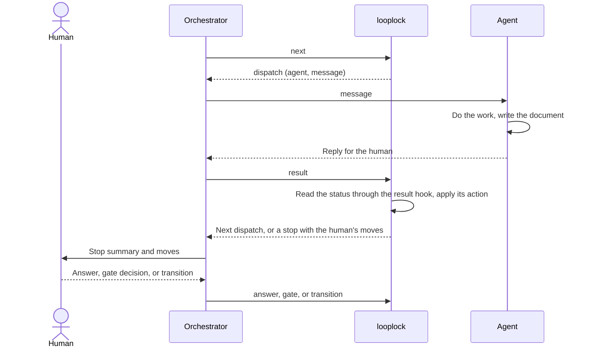

# Looplock

LLMs do the work. Looplock decides what happens next.

Looplock is a deterministic control plane for agentic engineering workflows. It moves routing, retries, approvals, failures, and stop conditions out of prompts and into a loop file and code that you can test.

## The problem

A multi-agent workflow often keeps its control logic in prose: orchestration prompts, instructions in `AGENTS.md` files and agent definitions, conventions about which agent runs next, and ad hoc retry limits. This works for simple happy paths. It gets much harder to reason about once the workflow has to support human decisions, retries, partial failures, invalidated work, and resumed runs.

At that point the workflow is a state machine, implemented partly in natural language. The LLM does the work, and you also ask it to remember and enforce the protocol that governs the work. The more important the workflow becomes, the less you want to rely on that.

Consider a dependency remediation workflow: discover the dependency, analyze its reachability, propose a fix, get a security approval, implement the fix, run the tests, and verify that the vulnerability is gone. An LLM can do most of those steps. Don't let it decide whether the approval can be skipped, whether a failed verification can be ignored, or whether the run has retried too many times. A loop file makes those decisions instead: the run can't reach the implementation without the approval, a failed verification sends the run back to the implementation, and a limit parks the run after too many failures.

## How Looplock works

Agents own execution. Looplock owns protocol. A dispatch can go to Claude Code, Codex, a custom MCP agent, a CI process, or a human, and Looplock handles each the same way: it needs a dispatch message and a document with a status.

Your orchestrator drives the loop with two calls, plus one command for each human move. `next` prints the move the run needs. `result` hands the document the agent wrote to the loop's result hook, and applies the action of the status the hook returns. The following diagram shows one dispatch and one human stop:



The `looplock` CLI keeps each run's state in a `run.json` file and refuses any move the loop doesn't declare. The orchestrator doesn't interpret routing instructions: it carries each message to its agent and each result back to the CLI, and it can be an agent, a script, or you at a terminal. A sub-agent doesn't need the orchestration graph either. It receives one task, performs it, and writes one document whose frontmatter carries its status. The agent can still write a human-readable reply, but Looplock reads only the document, and only through your hooks.

## A loop in code

A loop is one JSON file: its inputs, its artifacts, and an ordered list of stages. Each condition the engine can't know, such as how to read a document's status or when the plan is ready for its gate, is a hook: a named export of an ES module beside the loop file. The following listing is `examples/default/default.loop.json`:

```json
{
  "name": "default",
  "inputs": { "required": ["subject"] },
  "questions": "Q-{n}.md",
  "result": { "module": "./hooks.mts", "export": "readResult" },
  "onAnswer": { "module": "./hooks.mts", "export": "onAnswer" },
  "artifacts": {
    "plan": { "file": "plan.md", "guard": { "module": "./hooks.mts", "export": "planGuard" } },
    "build-report": { "file": "build.{attempt}.md" },
    "verify-report": { "file": "verify.{attempt}.md" }
  },
  "stages": [
    { "plan": "plan", "route": { "module": "./hooks.mts", "export": "route" }, "dispatches": {
      "planner": { "agent": "planner", "artifact": "plan", "message": "Plan {subject}. Run: {runPath}. Note: '{note}'.",
        "outcomes": { "ok": { "route": true }, "needs-decisions": { "ask": true }, "blocked": { "park": true } } } } },
    { "gate": "gate", "label": "Gate", "freezes": ["plan"] },
    { "work": "build", "dispatch": { "agent": "builder", "artifact": "build-report", "message": "Build the plan. Run: {runPath}. Report: {document}. Note: '{note}'." } },
    { "verify": "verify", "dispatch": { "agent": "verifier", "artifact": "verify-report", "message": "Verify the build. Run: {runPath}. Report: {document}." }, "maxFailed": 3 },
    { "end": "done" }
  ],
  "limits": { "redispatch": 2, "unusable": 1 }
}
```

The hooks are plain functions that import nothing from Looplock. The route in `hooks.mts`, shown here without its types, sends the run to the gate after the plan says `ok` and no human note came after the planner's last dispatch:

```ts
export function route({ runDir, run }) {
    const plan = join(runDir, 'plan.md');
    const since = run.dispatches.findLast((d) => d.name === 'planner')?.openedAt ?? '';
    const noted = run.history.some((h) => h.human && h.at > since);
    return existsSync(plan) && frontmatter(plan)?.status === 'ok' && !noted ? { gate: 'gate', onRefusal: 'planner' } : { dispatch: 'planner' };
}
```

The stage order supplies the targets the loop file leaves out: the gate moves to `build` on an approval and back to `plan` on a rejection, and the verify stage moves to `done` on `pass` and back to `build` on `fail`. The stage kinds supply the builder's and the verifier's standard outcomes, and the human's moves from each state. An explicit value always wins. A verify stage gets no forward exit except a verdict, so the run reaches `done` only through `pass`. To print every state, target, outcome, and human edge the stages compile to, with the pointer of each inferred value, run `node bin.mts compile --config examples/default/default.loop.json`. For every field, see [Configuration](docs/configuration.md).

## Scope

Looplock isn't an agent framework. It never starts an agent: `next` prints the dispatch, and your runtime runs it. It doesn't decide how an agent reasons, which model it uses, or how it edits code. It never parses your documents: it hashes files for freezes, compares a document's modification time with its dispatch, lists question files by name, and hands every path to a hook. It also isn't a durable execution platform such as Temporal: it has no distributed scheduling, queues, cloud execution, model hosting, or agent memory.

The package holds only the engine, the CLI, and the MCP server. The default loop in `examples/default/` is a starting point to copy, not part of the package.

Its scope is small on purpose. Looplock fits workflows where agents or humans do the work, where failures and approvals matter, and where the protocol matters enough to formalize, inspect, and test.

## What the engine enforces

Looplock makes one promise:

> Looplock guarantees that a run moves only along the transitions its loop declares, and it records every human move. It doesn't judge a verdict or prove who made a move: the consumer's validators guard honest verdicts, and the MCP client authorizes each human move interactively. A consumer's preflight can refuse the client configurations it knows to approve human moves automatically. Neither the engine nor a consumer can prove that a human clicked.

The engine checks the run file on every call. These rules hold for every loop:

- **Valid transitions.** A run moves only along the states its stages compile to, and a state's validator runs on every transition into it.
- **Gate approvals and freezes.** A run leaves a gate forward only after a human approves it. The approval freezes the files the gate names. A changed frozen file stops the run until a human moves it back past the gate, which drops the freeze.
- **One human edge set per state.** A human moves with `transition` only along the human edges the compiler gives the current state. Every stop lists the human's moves as data: the call that records each move, and what the call changes.
- **Answers, all or none.** An `answer` call records all of its answers or none of them. For each answer, the call runs the loop's `onAnswer` hook, then freezes the question file.
- **Bounded re-dispatches.** The CLI re-dispatches an unusable or refused result with the reason, and parks the run for a human past a limit.

For every rule and the terms it uses, see [Protocol rules](docs/protocol.md).

## Quick start

You need Node.js 22.18 or later. Looplock has no npm dependencies, and development has no build step. Clone the repository, run the tests, and start a run of the default loop:

```bash
git clone https://github.com/push-based/looplock.git
cd looplock
node --test '**/*.spec.mts'
node bin.mts new --config examples/default/default.loop.json --run runs/example/run.json --subject 'the settings page'
node bin.mts next --run runs/example/run.json
```

`next` prints the first dispatch, the planner's message:

```json
{"do":"dispatch","id":1,"agent":"planner","message":"Plan the settings page. Run: runs/example/run.json. Note: ''."}
```

To play each agent by hand through the gate, the build, and the verification, continue with [Run the default loop by hand](docs/tutorial.md). To start a loop of your own, copy `examples/default/`, as [The default loop](examples/default/README.md) describes.

## Documentation

The following pages cover the rest:

- [Run the default loop by hand](docs/tutorial.md): play every agent and take a run to `done`.
- [Protocol rules](docs/protocol.md): the promise, the terms, and the rules.
- [Configuration](docs/configuration.md): the loop file, stage kinds, inferred values, human edges, actions, placeholders, and hooks.
- [CLI reference](docs/cli.md): the commands, their flags, and the exit codes.
- [MCP server](docs/mcp.md): drive a run through MCP tool calls.
- [The default loop](examples/default/README.md): the example loop, its hooks, and its agent templates.
- [Testing](docs/testing.md): test a loop with `node:test`, and run the engine's tests.
- [Run format](docs/run-format.md): the files a run writes.
