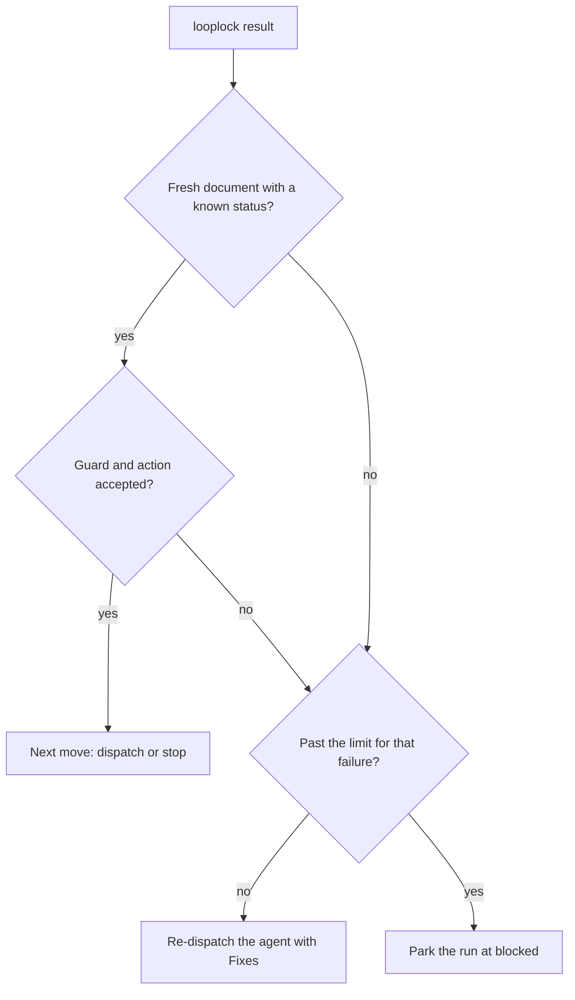

# Protocol rules

The engine checks these rules against the run file on every call. A loop file names the stages, the artifacts, the dispatches, and the hooks, and the rules hold for every loop.

## The promise

Looplock makes one promise:

> Looplock guarantees that a run moves only along the transitions its loop declares, and it records every human move. It doesn't judge a verdict or prove who made a move: the consumer's validators guard honest verdicts, and the MCP client authorizes each human move interactively. A consumer's preflight can refuse the client configurations it knows to approve human moves automatically, as the FDS Kiro integration does. Neither the engine nor a consumer can prove that a human clicked.

## Terms

The rules use these terms:

- **Stage**: a state of the loop, of one of six kinds: plan, gate, work, verify, stop, or end. The loop file lists the stages in order, and the order supplies the targets a stage leaves out.
- **Dispatch**: one task for one agent, as a message. Each dispatch declares its artifact and owns the outcomes its status can take.
- **Artifact**: a file in the run folder, by name, with an optional guard. A name with `{attempt}` makes a per-attempt artifact, a new file for each dispatch.
- **Document**: the file a dispatch writes: its artifact's file, with `{attempt}` filled in. Its status is the step's status.
- **Freeze**: the sha256 of a file, recorded in the run when a gate approves or a question is answered. A later transition refuses a changed frozen file.
- **Question**: a file in the run folder whose name matches the loop's `questions` pattern, such as `Q-1.md`. The engine keeps its id, its file, and the human's answer, never its text.
- **Hook**: a named export of an ES module that the loop file names, relative to the loop file. The engine awaits each hook and hands it every path. A hook reads the run and never changes it.
- **Guard**: an artifact's hook, which returns the error lines that refuse its file.
- **Validator**: a state's hook, which returns the error lines that refuse a transition into that state.
- **Park**: move the run to `blocked` with a note, and wait for a human.

## Rules

The engine enforces the following rules. [Configuration](configuration.md) names each field they read.

### Transitions

Every status change goes through one transition, which runs these steps in order:

1. **Edge.** A human move needs a note, no open dispatch, and one of the current state's human edges. Any other move needs a target in the compiled states, or `blocked`. A gate's forward exit needs the gate approved, and a human move can't take a gate's exits or a verify stage's `pass`.
2. **Freeze drop.** A human edge that drops a gate's freeze deletes the gate's freezes and its decision. The gate's history stays.
3. **Freeze check.** Unless the target is `blocked`, every frozen file must be unchanged. A missing or changed file fails the move and names the gate or the question that froze it.
4. **Gate entry.** Entering the freezing gate, other than by its own decision, needs no pending question, and each frozen artifact's guard runs with `event: 'enter'`. Leaving the initial state for any target but `blocked` also needs no pending question.
5. **Validator.** Unless the target is `blocked`, the target's validator runs, and its errors refuse the move.
6. **Record.** A move to `blocked` needs a note and records the state it blocked from. The engine appends the move to the history, and marks a gate decision and a human transition as human.

A refused gate entry or validator during an agent's outcome or the route re-dispatches the agent with the errors. A freeze failure parks the run instead, because no agent can repair a frozen file. A human move reports either error and changes nothing.

### Human moves

A human has three moves: `answer` a question, approve or reject a `gate` with a note, and `transition` along a human edge with a note. The compiler gives each state its human edges:

- Every stage after the freezing gate, except an end stage, has an edge back to the gate's `back`, which drops the gate's freeze.
- A stop stage after a verify stage, and the verify stage itself, have an edge that retries the verify stage's `fail`.
- An edge into the stage that `maxFailed` guards resets the failed count.
- A blocked run resumes into the state it blocked from, or takes a human edge of that state. It leaves `blocked` no other way.

Every stop lists the human's moves from the current state as lines, with the effect of each, and the preflight warnings while the freezing gate isn't approved. A loop with no freezing gate always shows them. The orchestrator shows both word for word.

### Gates and questions

- An approval runs the frozen artifacts' guards with `event: 'approve'`, records the sha256 of each frozen file, freezes those files, and moves the run to the gate's `next`.
- A rejection needs a note, records it, and moves the run to the gate's `back`. Nothing freezes.
- At `result`, while the run is at the initial state, each new file that matches `questions` joins the ledger as pending.
- An answer needs the initial state and a pending question. The loop's `onAnswer` hook writes the answer into the question file, and then the engine resolves the question and freezes its file. A throw from the hook records nothing.

### Results

`result` reads the open dispatch's document and applies the action of its status:

1. **Freshness.** The document must exist, written no earlier than its dispatch opened.
2. **Status.** The result hook returns the status, which must be an outcome of the dispatch.
3. **Guard.** Unless the action parks, the artifact's guard runs with `event: 'result'`.
4. **Questions.** At the initial state, new question files join the ledger.
5. **Action.** `transition` moves the run, `route` asks the route for the next move, `ask` stops on the pending questions, and `park` blocks the run.

A document that fails steps 1 or 2 is unusable. A guard error, a refused transition, or an `ask` with no pending question is a refusal. The CLI re-dispatches the agent with the error lines after `Fixes:`, and parks the run past `limits.unusable` unusable results or `limits.redispatch` refusals in a row. The following diagram shows how `result` handles a document:

### The failed count

A verify stage with `maxFailed` counts the failed verdicts that sent the run back to its `fail` stage since the latest human move into that stage, such as the gate approval or a retry. When the count reaches `maxFailed`, `next` parks the run with a note that names the latest report.

### The loop file

A run records one sha256 over its loop file and every hook module, with each module's local static imports, transitively. The CLI refuses every command of a run after any of them changes, so start a new run after you edit a loop.
