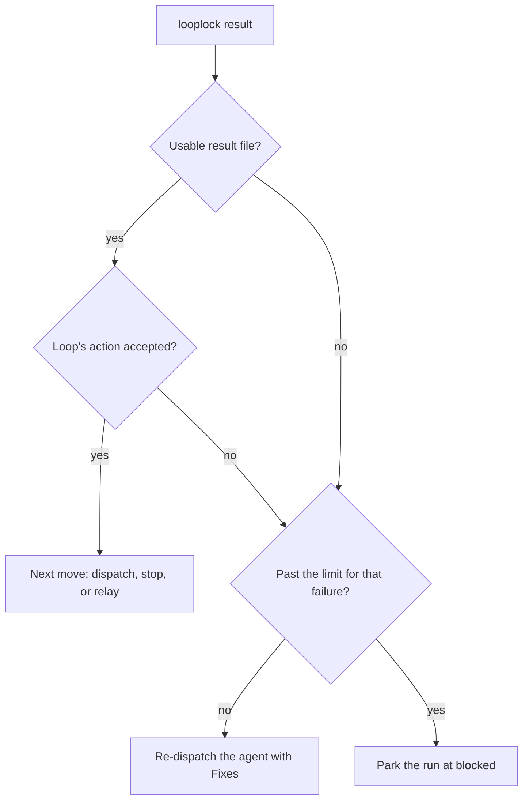

# Protocol rules

The engine checks these rules against the run file on every call. A loop configuration names the statuses, the gates, and the routes, and the rules hold for every loop.

## Terms

The rules use these terms:

- **Dispatch**: one task for one agent, as a message and the path of the result file the agent writes.
- **Artifact**: a file an agent stores in the run, such as a plan.
- **Gate**: a status where the run waits for a human to approve or reject an artifact. An approval freezes the artifact.
- **Decision**: a human's answer to an agent's question, kept in the run's ledger.
- **Park**: move the run to `blocked` and wait for a human.

## Rules

The engine enforces the following rules:

- A run moves only along the configured `states`.
- A run leaves a gate for the gate's `next` status only after a human approves the gate. To enter a gate, the run needs the artifact the gate freezes, no pending question, and every active decision applied in that artifact.
- A verdict moves a run out of a verify status. A pass needs every obligation of its phase proven, as [Verification and obligations](#verification-and-obligations) describes.
- A blocked run resumes only into the status it blocked from, and a move to `blocked` needs a note.
- A run cites each proof report once, and the CLI refuses a reused report.
- Looplock stores each artifact beside the run file with its sha256, and refuses to load a file that changed. It never overwrites a versioned artifact.
- After approval, the artifact a gate froze can't change until `invalidate` re-opens it.
- The run keeps human decisions in an append-only ledger. A decision stays active until a later decision supersedes it.
- A run records its configuration file's sha256, and the CLI refuses every command after that file changes.

## Result handling

A result that breaks a rule leaves the run where it was. The CLI re-dispatches the agent with the reason, and parks the run for the human after too many failures in a row. Unusable results and refused actions count against separate limits. A usable result file exists, parses as JSON, names a status the loop knows for that agent, and carries the field that status requires.

The following diagram shows how `result` handles a result file:

## Verification and obligations

An obligation is a claim in the frozen artifact that a verifier must prove before the run passes a verify phase. The engine reads each obligation's `id`, `phase`, and `tier`, the kind of proof the claim needs. The CLI's messages call the tier the evidence mode. The default agents also write a `claim`, the observable the verifier checks.

A pass must name each obligation of its phase as `<ID>:<TIER>`, with the tier the artifact gives it. When a verifier's result misses one, the CLI refuses the pass and re-dispatches the verifier with the unmet obligations after `Fixes:`. Steps 7 and 8 of [Run the default loop by hand](tutorial.md) show both results.

A verify phase with `checks: true` also needs an all-pass checks record for the current attempt, which the `checks` command writes.

A run leaves a verify status only through a verdict when that status's `states` entry lists no exit except `blocked`, as the default preset's does. A verify status that lists another exit lets `transition` skip the verification.
