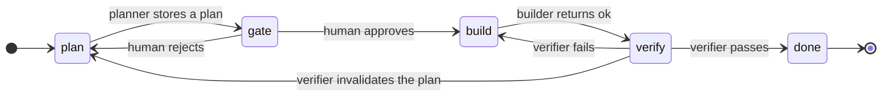

# Run the default loop by hand

This tutorial runs the default preset, `presets/default.mts`, without any agent. You play every agent yourself and write each result file by hand.

The default preset is a plan, gate, build, and verify loop. The following diagram shows its statuses and what moves the run between them:



The run also stops in two places the diagram leaves out. At `plan`, the run waits for you when the planner asks questions, and it continues after you answer them. Any status except `done` can move to `blocked`, when an agent returns `blocked` or a limit runs out, such as 3 failed verifications since the approval. A blocked run resumes only into the status it blocked from.

## Take a run to done

Run these steps from the repository root. If you followed the quick start in the README, your run is ready for step 3.

1. Start a run:

   ```bash
   node bin.mts new --config presets/default.mts --run runs/example/run.json --subject 'the settings page'
   ```

   The CLI prints `{"ok":true,"status":"plan"}`.

2. Ask for the next move:

   ```bash
   node bin.mts next --run runs/example/run.json
   ```

   The run is at `plan`, so the CLI dispatches the planner:

   ```json
   {"do":"dispatch","id":1,"agent":"planner","message":"Plan the settings page. Run: runs/example/run.json. Result: runs/example/results/1.json."}
   ```

3. As the planner, write a plan with one build obligation, and a result file that names the plan:

   ```bash
   cat > runs/example/plan.json <<'EOF'
   {
     "steps": ["Add the settings form"],
     "decisionsApplied": [],
     "obligations": [{ "id": "O1", "phase": "build", "claim": "Saving the form persists every field", "tier": "TEST" }]
   }
   EOF
   echo '{"status":"ok","plan":"runs/example/plan.json","gaps":[]}' > runs/example/results/1.json
   ```

4. Record the planner's result:

   ```bash
   node bin.mts result --run runs/example/run.json
   ```

   The CLI stores the plan as `plan.1.json` and stops at the gate for a human decision:

   ```json
   {"do":"stop","stop":"gate","gate":"gate","since":[{"id":1,"agent":"planner","outcome":"ok"}]}
   ```

5. As the human, approve the plan. The approval freezes `plan.1.json`, and the run moves to `build`:

   ```bash
   node bin.mts gate gate --run runs/example/run.json --decision approved
   ```

6. Run `next` for the builder's dispatch. Then, as the builder, write your result and record it:

   ```bash
   node bin.mts next --run runs/example/run.json
   echo '{"status":"ok"}' > runs/example/results/2.json
   node bin.mts result --run runs/example/run.json
   ```

   The CLI moves the run to `verify` and dispatches the verifier.

7. As the verifier, write a report and a pass that leaves out obligation `O1`, and record it:

   ```bash
   echo '# verify 1' > runs/example/verify.1.report.md
   echo '{"status":"pass","report":"runs/example/verify.1.report.md","obligations":[]}' > runs/example/results/3.json
   node bin.mts result --run runs/example/run.json
   ```

   The CLI refuses the pass and dispatches the verifier again, with the refusal after `Fixes:`:

   ```json
   {"do":"dispatch","id":4,"agent":"verifier","message":"Verify the build against runs/example/plan.1.json. Run: runs/example/run.json. Fixes: a build pass needs proof of every build obligation in its evidence mode; unmet: O1 (TEST) Result: runs/example/results/4.json."}
   ```

8. Write a new report and a pass that proves `O1` in its tier, and record it:

   ```bash
   echo '# verify 2' > runs/example/verify.2.report.md
   echo '{"status":"pass","report":"runs/example/verify.2.report.md","obligations":["O1:TEST"]}' > runs/example/results/4.json
   node bin.mts result --run runs/example/run.json
   ```

   The run stops at `done`. Run `node bin.mts show --run runs/example/run.json` for the run's summary.

To start over, delete `runs/example/`. For the files the run wrote, see [Run format](run-format.md). To drive the same loop with agents, see [Writing agents](../default-agents/README.md).
