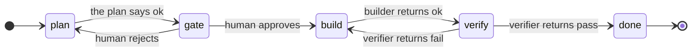

# Run the default loop by hand

This tutorial runs the default loop in `examples/default/` without any agent. You play every agent yourself and write each document by hand.

The default loop is a plan, gate, build, and verify loop, written as three steps, a gate, and a stop in `default.loop.json`. The following diagram shows its states and what moves the run between them:



The run also stops in places the diagram leaves out. At `plan`, the run waits for you when the planner writes a question file, such as `Q-1.md`, and it continues after you answer. Any step can move to `blocked`, when an agent returns `blocked` or a step opens more than 3 times since your last move, such as a fourth build after 3 failed verifications. Every stop lists your moves from there, such as a `transition` back to `plan`.

To see each step's outcomes and their targets, run `node bin.mts compile --config examples/default/default.loop.json`.

## Take a run to done

Run these steps from the repository root. If you followed the quick start in the README, your run is ready for step 3.

1. Start a run:

   ```bash
   node bin.mts new --config examples/default/default.loop.json --run runs/example/run.json --subject 'the settings page'
   ```

   The CLI prints `{"ok":true,"status":"plan","warnings":[]}`.

2. Ask for the next move:

   ```bash
   node bin.mts next --run runs/example/run.json
   ```

   The run is at `plan`, so the CLI dispatches the planner:

   ```json
   {"do":"dispatch","id":1,"agent":"planner","message":"Step: plan\nRun: runs/example/run.json\nDocument: runs/example/plan.md\nInputs:\n  subject: the settings page\nNote: none\nFixes: none"}
   ```

3. As the planner, write the plan to `plan.md` in the run folder. Its frontmatter carries its `id` and its status:

   ```bash
   printf -- '---\nid: plan\nstatus: ok\n---\n\n# Plan\n\n- Add the settings form.\n' > runs/example/plan.md
   ```

4. Record the planner's result:

   ```bash
   node bin.mts result --run runs/example/run.json
   ```

   The plan says `ok`, so the machine moves the run into the gate, and the run stops for your decision. The stop lists your moves and the file an approval freezes:

   ```json
   {"do":"stop","stop":"gate","status":"gate","gate":"gate","label":"Gate","freezes":["runs/example/plan.md"],
    "moves":[{"call":"gate","gate":"gate","decision":"approved","to":"build","freezes":["runs/example/plan.md"]},{"call":"gate","gate":"gate","decision":"rejected","to":"plan"}],
    "warnings":[],"since":[{"id":1,"name":"plan","agent":"planner","attempt":1,"outcome":"ok","minutes":0}],"recorded":[]}
   ```

5. As the human, approve the plan. The approval freezes `plan.md`, and the run moves to `build`:

   ```bash
   node bin.mts gate gate --run runs/example/run.json --decision approved --note 'Looks right.'
   ```

6. Run `next` for the builder's dispatch. Its message names the builder's document, `runs/example/build.1.md`, and carries your note:

   ```bash
   node bin.mts next --run runs/example/run.json
   ```

7. As the builder, write the document, and record it. The CLI moves the run to `verify` and dispatches the verifier, whose document is `verify.1.md`:

   ```bash
   printf -- '---\nid: build-1\nstatus: ok\n---\n\nAdded the form.\n' > runs/example/build.1.md
   node bin.mts result --run runs/example/run.json
   ```

8. As the verifier, fail the build, and record it:

   ```bash
   printf -- '---\nid: verify-1\nstatus: fail\n---\n\nSaving drops the email field.\n' > runs/example/verify.1.md
   node bin.mts result --run runs/example/run.json
   ```

   The run moves back to `build`, and the CLI dispatches the builder again. The retry writes a new document, so the first one stays:

   ```json
   {"do":"dispatch","id":4,"agent":"builder","message":"Step: build\nRun: runs/example/run.json\nDocument: runs/example/build.2.md\nInputs:\n  subject: the settings page\nNote: none\nFixes: none"}
   ```

9. As the builder, write the second document, and record it:

   ```bash
   printf -- '---\nid: build-2\nstatus: ok\n---\n\nFixed the email field.\n' > runs/example/build.2.md
   node bin.mts result --run runs/example/run.json
   ```

10. As the verifier, pass the build, and record it:

    ```bash
    printf -- '---\nid: verify-2\nstatus: pass\n---\n\nEvery field persists.\n' > runs/example/verify.2.md
    node bin.mts result --run runs/example/run.json
    ```

    The run stops at `done`, with no moves left. Run `node bin.mts show --run runs/example/run.json` for the run's state.

To start over, delete `runs/example/`. For the files the run wrote, see [Run format](run-format.md). To drive the same loop with agents, see [The default loop](../examples/default/README.md).
