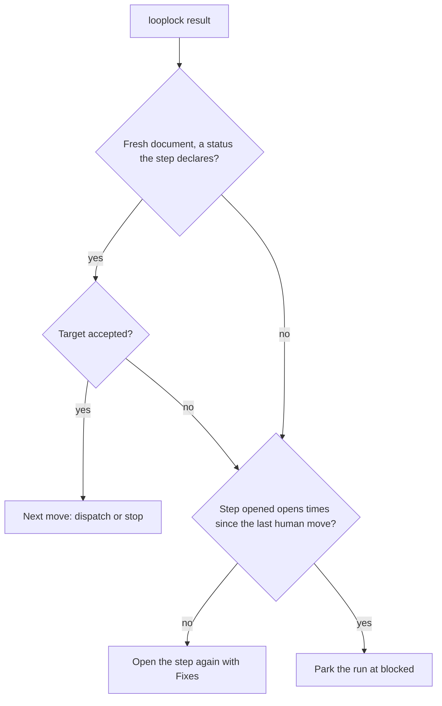

# Protocol rules

The engine checks these rules against the run file on every call. A loop file names the steps, gates, stops, artifacts, the machine, and the hooks, and the rules hold for every loop.

## The promise

Looplock makes one promise:

> Looplock guarantees that a run moves only along the transitions its loop declares, and it records every human move. It doesn't judge a verdict or prove who made a move: the consumer's guards and entry checks guard honest verdicts, and the MCP client authorizes each human move interactively. A consumer's preflight can refuse the client configurations it knows to approve human moves automatically. Neither the engine nor a consumer can prove that a human clicked.

## Terms

The rules use these terms:

- **Step**: a state where one agent works on one document. It declares the outcomes its document's status can take.
- **Gate**: a state where the run waits for a human decision, approve or reject.
- **Stop**: a state where the run waits for a human with no agent to open. A stop with no human moves is terminal.
- **Machine**: the target of each step outcome and each gate decision.
- **Artifact**: a file in the run folder, by name, with an optional guard. A name with `{attempt}` makes a per-attempt artifact, a new file for each open.
- **Document**: the file a step writes: its artifact's file, with `{attempt}` filled in.
- **Dispatch**: one open of a step, as the standard message to its agent.
- **Freeze**: the sha256 of a file, recorded in the run when a gate approves or a question is answered. A later transition refuses a changed frozen file.
- **Question**: a file in the run folder whose name matches the loop's questions pattern, such as `Q-1.md`. The engine keeps its id, its file, and the human's answer, never its text.
- **Hook**: a named export of an ES module that the loop file names as `"<file>#<export>"`. The engine awaits each hook and hands it every path. A hook reads the run and never changes it.
- **Guard**: an artifact's hook, which returns the document's status or the error lines that refuse it.
- **Entry check**: a step's, gate's, or stop's `onEnter` hook, which returns the error lines that refuse a transition into it.
- **Park**: move the run to `blocked` with a note, and wait for a human.

## Rules

The engine enforces the following rules. [Configuration](configuration.md) names each field they read.

### Transitions

Every status change goes through one transition, which runs these steps in order:

1. **Move.** A human move needs a note, no open dispatch, and one of the current state's human moves. A machine move never leaves `blocked`. A move to `blocked` needs a note.
2. **Freeze drop.** A human move or a gate decision into a step that writes a frozen artifact deletes that gate's freezes and its decision. The gate's history stays. The same moves re-freeze the answered question files at their current bytes.
3. **Freeze check.** Unless the target is `blocked`, every frozen file must be unchanged. A missing or changed file fails the move and names the gate or the question that froze it.
4. **Gate entry.** Entering a gate needs no pending question, runs the guard of each artifact the gate freezes with `event: 'enter'`, and needs every frozen file present.
5. **Entry check.** Unless the target is `blocked`, the target's `onEnter` runs, and its errors refuse the move.
6. **Record.** A move to `blocked` records the step it parked from. The engine appends the move to the history, and marks a gate decision and a human transition as human.

A refused gate entry or entry check during an agent's outcome opens the step whose outcome led there again, with the errors as its fixes. A freeze failure parks the run instead, because no agent can repair a frozen file. A human move reports either error and changes nothing.

### Human moves

A human has three moves: `answer` questions, approve or reject a `gate` with a note, and `transition` along a human move with a note. The loop file lists each state's human moves under `human`. A blocked run resumes into the step it parked from, or takes a human move of that step. It leaves `blocked` no other way.

Every stop lists the human's moves as data: the call that records each move, the arguments the call takes, and what the call changes besides the status. Every stop also carries the preflight warnings, `since`, the dispatches since the latest human move, and `recorded`, the human moves since the latest closed dispatch. A gate stop after an earlier decision also names that decision under `last`, and under `changed` the frozen files whose bytes differ from the ones the human judged then. The orchestrator words the moves for the human, and decides when to show the rest.

### Gates and questions

- An approval runs the frozen artifacts' guards with `event: 'approve'`, records the sha256 of each frozen file, freezes those files, and moves the run to `"<gate>.approve"`.
- A rejection needs a note, records it, and moves the run to `"<gate>.reject"`. Nothing freezes.
- At `result`, each new file that matches the questions pattern joins the ledger as pending, at any state.
- Pending questions stop the run before any step opens.
- An `answer` call records one or more answers, all or none, at any state. The engine checks every answer first and refuses the call with every problem: a question that isn't pending, an empty option or answer, or a question that appears twice. Then, for each answer in order, the loop's `onAnswer` hook writes it into the question file, and the engine freezes the file and resolves the question. A throw from the hook refuses the call, and the run records none of its answers. The engine doesn't undo what the hook wrote for the call's earlier answers.

### Results

`result` closes the open dispatch and follows the machine. Called with a dispatch id, it first refuses, before any hook runs, unless that dispatch is the open one. It returns `closed`, the dispatch it closed with its outcome, and the next move.

1. **Freshness.** The document must exist, written no earlier than its dispatch opened.
2. **Guard.** The artifact's guard runs with `event: 'result'`, and returns the status or the errors.
3. **Status.** The status must be an outcome of the step.
4. **Questions.** New question files join the ledger.
5. **Target.** `park` blocks the run, `{ask}` needs a pending question and moves into its step, and any other target is a transition.

A document that fails steps 1 or 3, or a guard that returns neither a status nor errors, is unusable. Guard errors, a refused transition, or an `ask` with no pending question is a refusal. Either way, `next` opens the same step again with the error lines after `Fixes:`. The following diagram shows how `result` handles a document:

### The opens limit

A step opens at most `limits.opens` times since the latest human move: a gate decision, a human transition, or an answer. The next open past it parks the run with a note that names the step's latest outcome, its document, and its fixes. The limit bounds a step that keeps failing its guard and a cycle between steps alike.

### The loop file

A run records one sha256 over its loop file and every hook module, with each module's local static imports, transitively. The CLI refuses every command of a run after any of them changes, so start a new run after you edit a loop.

### The engine version

A run records the Looplock version that started it. An engine of another version line refuses every command of the run: before 1.0, a line is a minor version, such as 0.4, and from 1.0, a major version. The refusal names the command that continues the run under its own line, such as `npx @push-based/looplock@0.4`.

### The run file

For how commands lock and save the run, see [One command at a time](cli.md#one-command-at-a-time).
